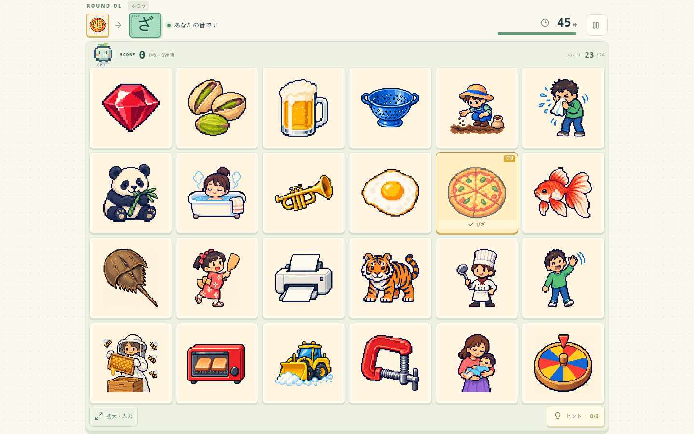
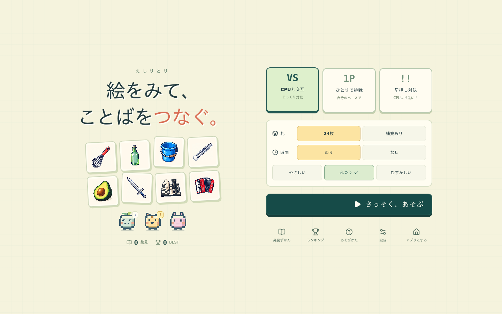
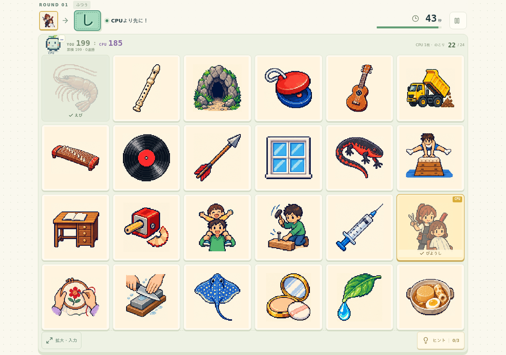
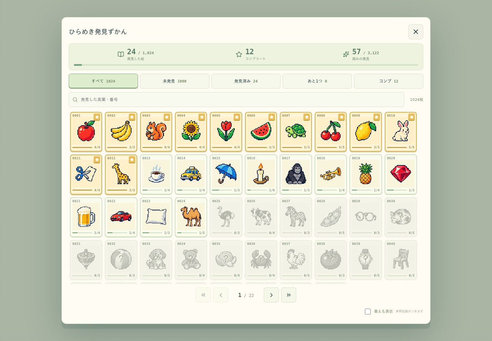
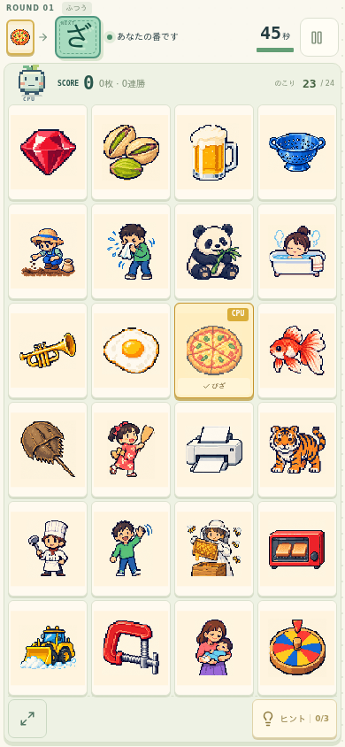

# えしりとり 連戦

絵をみて、ことばをつなぐ。1,024種類のドット絵から「その読みもあり！」を見つける、ブラウザで遊べる絵しりとりゲームです。



**1,024枚の絵札 · 3,122件の読み · CPU対戦／ひとり／早押し · スマホ縦画面対応**

[起動する](#起動する) · [遊び方](#遊び方) · [ゲームモード](#ゲームモード) · [開発ガイド](docs/development.md)

## 遊び方

1. 次の文字から始まる絵を探してタップします。
2. 絵の名前に加え、別名・動作・特徴からの「裏読み」も正解になります。正解すると読みと理由を表示します。
3. 札を取りながらスコアと連勝を伸ばし、新しい読みを図鑑へ集めましょう。

**「ん」で終わる読みを確定するか、時間切れになると負け。** 時間ありでは誤答で残り時間が5秒減ります。同じ盤面で使った札・言葉は再使用できません。

安全につながる札がなくなったら盤面を終了します。交互対戦・ひとりモードではクリアとなり、連勝を加算。早押しではその盤面の得点で勝敗を決めます。**負けていなければ、次の盤面にも自分の累積スコアを引き継ぎます。**

### 表読みと裏読み

通常のタップは表読みを優先します。「拡大・入力」から絵を選ぶと、かな入力や発見済みの読みの選択ができます。裏読みには専用の色・星・音、初発見にはNEW演出があります。ヒントは説明 → 読みの種類・文字数・穴あき → 答えの3段階です。

読みは全1,024枚を個別に見直し、絵から読み取れる別名や見立てを採用しています。採用3,122件は画像ごとの読みの数で、重複を除いた言葉は2,275語です。[全件の見直し記録](reports/reading-review/panel-review.md)

## ゲームモード



| モード       | 遊び方                                                                                              |
| ------------ | --------------------------------------------------------------------------------------------------- |
| CPUと交互    | CPUと1枚ずつ交代。最初の1枚も、CPUが探してから選びます。                                            |
| ひとりで挑戦 | 自分のペースで読みを探し、得点と発見を積み重ねます。                                                |
| 早押し対決   | CPUより先に札を取る勝負。YOUとCPUの盤面得点を比べ、高い方が勝利。同点は引き分けで連勝を維持します。 |

どのモードも **24枚／補充あり、時間あり／なし、3段階の難易度** を選べます。時間なしは練習として遊べ、ランキングには登録しません。

補充ありでは取得した場所に新しい絵が現れます。追加札は、やさしい12枚・ふつう24枚・むずかしい48枚。補充を使い切ると札が減っていきます。

CPUは表読みを優先し、選択肢の中で長く続きやすい手を探します。交互対戦では札を探す動き、早押しでは回答直前に札へ向かうカーソルで、相手が選ぶ様子を伝えます。



### 得点・連勝・ランキング

| 加点                 |            点数 |
| -------------------- | --------------: |
| 安全な札を1枚取得    |           100点 |
| 裏読みで取得         |     さらに150点 |
| 時間ありで素早く回答 | さらに最大100点 |

「ん」で終わる札は0点。時間なしでは速度加点がありません。早押しのCPUにも同じ得点ルールを適用し、**現在の盤面得点と、自分の連戦累積を別々に集計**します。

自分が負けた後、次の盤面は累積0から再開します。新しく始める場合と「同じseedで再挑戦」も別の挑戦です。ランキングは対戦方式・補充・難易度・時間・ヒント／答え参照・再挑戦などの条件ごとに記録します。

保存とランキングは、そのブラウザ・接続先URL内に保管します。対戦相手はCPUです。

## 見つけて集める図鑑



未発見は淡いモノクロ、発見済みはカラー、すべての読みを発見すると金枠と星。1ページ48枚の一覧から、未発見・あと1つ・コンプリートで絞り込めます。まだ見つけていない読みは、文字数分の「？」で表示します。

答えを参照しても発見数は増えません。上の画像は状態の違いが分かるようにした**紹介用のサンプル発見データ**です。

## スマホ・タブレットでも



PCの横6×縦4から、スマホ縦画面では**横4×縦6**へ切り替わります。対戦画面はスクロールせず、札を大きく使う配置です。

- 一時停止、消音、「動きを減らす」に対応。タブを離れると自動ポーズします。
- キーボードはTabで移動、Enter／Spaceで回答。Shift＋Enterで札を拡大できます。
- PWAの「アプリにする」と、対応ブラウザでの全画面表示を用意しています。

PWAをスマホへインストールするには信頼されたHTTPSで配信してください。localhostは開発用の例外です。アプリ本体と閲覧済み画像を最大128リクエストまでキャッシュするため、未閲覧の絵や新しい対戦では通信が必要です。端末によって全画面の表示範囲は異なります。

## 起動する

**Node.js 22.12以上、npm、Git** を用意します。承認済みの配信用画像をリポジトリに含めているので、画像生成やAPIキーの準備は不要です。

```sh
git clone https://github.com/ochisamu/eshiritori.git
cd eshiritori
npm ci
npm run build
npm run serve
```

[http://localhost:4173](http://localhost:4173) を開いて遊びます。終了はサーバーのターミナルでCtrl＋C。2回目以降は、ビルド済みなら <code>npm run serve</code> で起動できます。

### 同じLANのスマホから開く

サーバーを起動したPCとスマホを同じLANに接続し、スマホで <code>http://&lt;ホストPCのLAN内IP&gt;:4173/</code> を開きます。サーバーは <code>0.0.0.0</code> で待ち受けます。接続できない場合は、ホスト側のファイアウォールと、WSL利用時のポート転送も確認してください。

LAN内のHTTP接続でもブラウザで遊べます。保存先はURLごとに分かれます。

## 会話できる対戦相手（追加モード）

ホストPCのOpenAI APIキーで、同じ盤面を見ながら話す相手を追加できます。交互対戦の時間なし・時間なし補充に対応し、自発的な反応、日本語音声・字幕、会話ヒント、Decisionsの表情を使えます。キーはホストにだけ保持し、開始ボタンを押すまで有料接続を作りません。

```sh
npm start
```

ゲームと会話は同じサーバーで動きます。キーは.env、またはホストPCのゲーム内「ホスト設定」から設定できます。localhostではコード入力不要です。LAN端末の音声には信頼済みHTTPSと、一回限りのQR／リンクを使います。[音声モードの起動・証明書・利用量・配布手順](docs/voice-opponent.md)

会話の開始は「会話する」→「会話を始めて遊ぶ」。接続後はマイクの入力メーターと字幕で認識状態を確認できます。[通常会話の検証](reports/voice-conversation/verification.md)

## 開発する

React・TypeScript・Viteで構成しています。効果音はWeb Audioで合成し、標準ゲームでは外部API・CDN・フォント取得を行いません。追加の会話モードだけがOpenAI APIを使います。

```sh
npm run dev          # 開発サーバー（通常 http://localhost:5173）
npm test             # 単体テスト
npm run build        # 辞書生成・型検査・本番ビルド
```

| 場所            | 内容                                        |
| --------------- | ------------------------------------------- |
| src/            | ゲームルール、盤面生成、CPU、UI、保存       |
| content/        | 辞書、原画・プロンプト、審査記録、ハッシュ  |
| public/assets/  | 承認済み画像の96／128／256／512px版         |
| tests/・tools/  | テスト、素材検証、制作・配信ツール          |
| spec/・reports/ | 仕様判断と検証記録                          |
| docs/           | 開発ガイド、Git管理方針、スクリーンショット |

詳しくは [開発・テスト手順](docs/development.md)、[Git管理方針](docs/version-control.md)、[スクリーンショットの再撮影](docs/screenshots/README.md) を参照してください。

### 検証記録

会話モードの実API・LAN・秘密情報・互換性の確認は[音声追加の検証報告](reports/voice/verification.md)にまとめています。実機スマホのマイクと、人による会話の自然さ・音質評価は未確認です。

音声追加前のゲームの検証は、単体167件、UI321件、PWA9件、シミュレーション450試合を解決済みです。実施条件と再確認の内訳は [検証報告](reports/race-score/verification.md) に記録しています。Gitの基準版は [クリーンなチェックアウトからの再現確認](reports/git-baseline/verification.md) も行っています。

スマホ・タブレットの表示はブラウザ自動操作で確認しています。実機iOS／仮想キーボードと、スピーカー出力の聴感評価は未実施です。

## 素材と制作記録

絵は本プロジェクト向けに生成し、原画・プロンプト・変換履歴・個別ハッシュを保存しています。原作の絵しりとりから着想を得た独自ルールのゲームです。参考資料とルール上の判断は [spec/decisions.md](spec/decisions.md)、素材の出典と依存ライブラリのライセンスは [LICENSES.md](LICENSES.md) を参照してください。

[開発履歴と初版の制作・検証記録](docs/development-history.md)
