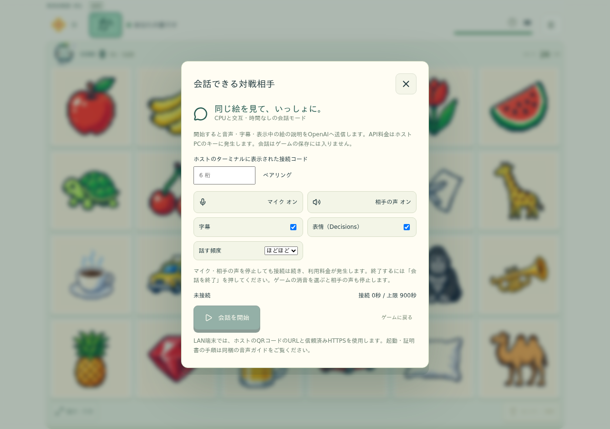

# 会話できる対戦相手

標準ゲームはこれまでどおりキーなしで遊べます。追加の会話モードは、ホストPCのOpenAI APIキーでGPT-Live・Responses・Decisionsを使います。対応するのは **CPUと交互の時間なし／時間なし補充**。回答はタップまたは既存の入力で行います。

採点・CPUの選択・勝敗・発見・乱数・保存は既存エンジンが担当します。手詰まりでは盤面クリアへ進みます。会話は操作待ちの理由になりません。

## ローカルで起動

Node.js 22.12以上を用意し、プロジェクトのルートで実行します。

```sh
npm ci
npm run build
npm run voice:build
```

.env.exampleを.envへコピーし、ホストPC上でOPENAI_API_KEYを設定します。既存の.envがある場合は上書きせず、必要な設定だけ追加してください。VITE_変数にはキーを入れません。

```sh
npm run voice
```

ターミナルのURL（既定は http://localhost:4174 ）を開きます。通常版の4173と同時に起動できます。ゲームの「会話する」からホストのターミナルに表示された6桁のコードでペアリングし、対応モードで「会話を開始」を押してください。

コードは1回限り・5分間有効です。成功すると新しいコードをホスト側へ表示します。期限切れのコードはホスト側で更新されます。同時に使える音声接続は1台です。



画像は会話未接続の設定画面です。

## 操作と利用量

- マイク、相手の声、字幕、発話頻度、Decisionsによる表情を別々に切り替えられます。
- マイク停止・音声停止は接続終了と別です。接続中は音声セッションの料金が発生します。
- 「会話を終了」で正常終了と利用量を待ちます。通信障害で確定できなければ未確定と表示します。
- 接続時間、音声の秒数、Responses／Decisionsの回数とトークン、設定単価による推定額を表示します。
- ヒントは「ヒントちょうだい」「もう少し」「もう一度」「答えを教えて」を区別します。再読では追加消費しません。
- 短い発話の語尾が欠けるなど意図が曖昧な場合は確認します。画面のヒントはいつでも既存のルールで使えます。
- ゲームの消音を選ぶと相手の声も停止します。音声の再開は会話パネルで明示的に操作します。

## 同じLANのスマホ・タブレット

マイクには信頼されたHTTPSが必要です。localhostは開発用の例外で、LAN内のHTTP URLには適用されません。

### 1. 証明書を用意する

利用者が管理する証明書、またはローカル専用CAを使用します。URLに使うIPアドレス／ホスト名をSANへ含めてください。ホストのIPが変わる場合は証明書と接続先も確認します。

OpenSSLがある場合、同梱ツールでローカルCAと90日間のサーバー証明書を作れます。

```sh
node tools/create-voice-certificate.mjs 192.168.1.20 my-game-pc
```

.voice/certificates/に作成します。既存の鍵や証明書は上書きしません。**OSの信頼設定・ファイアウォール設定は変更しません。**

- local-ca.crt：信頼させる端末へ手動で渡すCA証明書。
- local-ca.key、server.key：ホストにだけ残す秘密鍵。共有・Git登録・配布をしません。
- server.crt：ホストのHTTPSサーバー証明書。

スマホ・タブレット側で、内容と発行元を確認したlocal-ca.crtを利用者自身の判断で信頼設定に追加してください。iOS／iPadOSはプロファイル追加後の証明書信頼設定、AndroidはユーザーCAの導入とブラウザの対応確認が必要です。管理対象端末では管理者の手順に従います。証明書警告を無視する操作を通常の接続手順にしないでください。不要になったローカルCAは端末から削除します。端末の公式手順も参照してください：[Appleの証明書信頼設定](https://support.apple.com/ja-jp/102390)、[Googleの証明書管理（Pixel）](https://support.google.com/pixelphone/answer/2844832?hl=en)。

### 2. LANを明示的に有効にする

.envを次のように設定します。IP・ホスト名・パスは自分の環境に置き換えてください。

```dotenv
VOICE_LAN=true
VOICE_PORT=4174
VOICE_TLS_CERT=.voice/certificates/server.crt
VOICE_TLS_KEY=.voice/certificates/server.key
VOICE_ALLOWED_ORIGINS=https://192.168.1.20:4174,https://my-game-pc:4174
```

```sh
npm run voice
```

ホストのターミナルに表示するQRコードは接続URLだけを含みます。接続コード・Cookie・APIキーは含みません。スマホからURLを開いて証明書が正常なことを確認し、「会話する」でコードを入力、マイクを許可します。ホスト側にも接続料金が発生します。

### 3. Windows／WSLを使う場合

**WindowsのNode.jsで起動する経路**：ビルド済みのプロジェクトでWindows PowerShellからnpm run voiceを実行すれば、Windows上のサーバーへLAN接続できます。作業フォルダがWSLのUNCパス（\\wsl.localhost\\…）にある場合は、npmの子シェルの制限を避けて **node dist-voice/server/voice/index.js** を直接実行します。WSL内で作った証明書のパスは、Windowsから読めるパスにしてください。

**WSL内で起動する経路**：localhostの転送とLAN端末からの到達性は別です。WSLのネットワーク方式に応じて、ミラーネットワークまたはホスト側の転送設定が必要です。転送しても、ブラウザが開くURLと証明書SAN・許可Originを一致させます。

接続できなければ、まずホスト自身でHTTPSを開き、次にLANのIPで確認します。必要な受信許可は、利用者または管理者がプライベートネットワークの対象ポートへ限定して設定してください。このツールはOSの信頼ストア、WSL設定、転送、ファイアウォールを変更しません。

## 上限とモデル設定

モデル・声・時間・呼び出し上限は.env.exampleを参照してください。既定はLive 15分、ポーズ／結果／タイトルの無操作60秒、Responsesは毎分12回・接続120回、Decisionsは接続300回です。通常のプレイヤー思考中の沈黙で頻繁に切断しません。

VOICE_BUDGET_USDはホストプロセス内の推定による抑制です。モデルを変更するときは単価設定も更新してください。実際の請求額やAPI側の絶対上限を保証する設定ではありません。ホストを再起動するとプロセス内の集計はリセットされます。利用枠はOpenAI側でも管理してください。

単価の根拠（2026-10-31確認）：[公式料金](https://developers.openai.com/api/docs/pricing)。GPT-Liveは秒単位で、WebRTCの初期化には15秒分の扱いがあります。接続の作り直しも料金に影響します。

## 開発・障害対応

```sh
npm run voice:dev
```

開発サーバーにも.env・.voice・.cache・証明書の配信拒否を設定しています。旧静的サーバーのリポジトリ全体を配信する--devは使用できません。

Viteの開発プロキシを使う場合は、音声サーバー側のVOICE_ALLOWED_ORIGINSへhttp://localhost:5173を明示追加し、npm run devも起動します。LANの音声確認は本番ビルドのHTTPS配信を使用してください。

キー不正、モデル権限、利用枠、マイク許可、HTTPS、接続切断を区別して案内します。Live障害時は標準のタップ操作へ戻り、Decisions障害時は既存の表情へ戻します。自動で有料セッションを作り直しません。

テストは通常のnpm testに音声の境界・認可試験を含みます。実API試験は通常テストから実行されません。試験専用ツールを使う場合は、キー・予算・合成音声素材を明示的に準備してください。Windowsの日本語合成音声を使うtools/prepare-voice-test.ps1は、個人の会話を録音せず、試験素材を無視対象の.cache/voiceへ作ります。tools/voice-playtest.tsは専用ブラウザの保存領域で試遊します。実行にはVOICE_TEST_BUDGET_USD=5の明示指定が必要です。通常のnpm testでは課金しません。

## 秘密と保存

キーはホストの.env／環境変数だけで扱います。ブラウザにはSDPとアプリ用の認可情報だけを渡します。音声・全文文字起こしの保存機能は初期版にありません。会話は接続中のメモリだけに保持し、ゲームのセーブ・再挑戦コード・図鑑へ混ぜません。

音声APIはPWAキャッシュの対象外です。サーバーはdistの配信だけを行い、リポジトリや.envを配信しません。端末認可にはHttpOnly・SameSiteのCookie、変更要求にはCSRF検証、HTTPSではSecure属性を使います。Originは完全一致で検査します。

検証範囲と未確認事項は [検証報告](../reports/voice/verification.md) を参照してください。

## 実装上の接続方式

マイク入力はLiveのWebRTC、制御・字幕・操作確認は所有者限定のWSSで扱います。出力はsidebandで受ける24kHz PCMを同じ認可済みWSSへ中継し、AudioWorkletで再生します。ブラウザのネイティブWebRTC再生の差異を避け、古い手番の音声を端末上でも破棄できるようにした構成です。PCMはディスクへ保存しません。

出力キューは0.9秒以内。手番や盤面の更新・割り込みでキューを破棄し、古いrevisionの音声は受け付けません。音声の生成・字幕・実再生は別に扱います。Liveの文脈反映に伴うゼロ長区間やアプリのclient_event_idを持つ入力イベントを、人間の発話として使いません。

ローカルの音声検出と字幕の安定を合わせて要求を区切ります。Liveの委譲と同じ要求IDへ集約し、明確なヒント要求の委譲が届かなかった場合もResponsesの限定ツール経由で処理します。否定・曖昧な断片では消費しません。音声検出はアプリ内部の処理で、存在しないLiveの「発話完了」イベントは使用しません。

## 秘密を含めず配布する

Gitの作業コピーで本番ビルド・音声サーバービルド後、Python 3.9以上とGitを使って次を実行します。

```sh
python3 tools/package-voice.py
```

artifacts/eshiritori-voice-play.zip、eshiritori-voice-source.zipと、ZIP外のチェックサムを作成します。配布ツールは現在の実行ファイルと承認済み素材だけをplay版へ、ソースと原画をsource版へまとめます。Node.jsとnpmが必要です。play版は展開後に依存を復元し、起動します。

```sh
npm ci --omit=dev
npm run serve
# 会話を使う場合は自分の.envを用意して次を実行
npm run voice
```

配布には.env.exampleだけを含め、.env、.voice、証明書・秘密鍵、Cookie、音声、会話、キャッシュ、node_modulesを含めません。ホストのキーがファイルへ紛れ込んでいないかも作成時に照合します。受取人が自分のキーとLAN証明書を設定する方式です。
