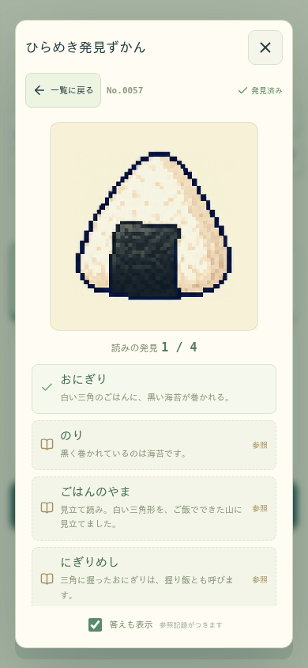

# 同一札の頭文字整理・読みの補填（2026-10-31）

全1,024札を走査して同じ頭文字の読みを整理し、絵に根拠がある別の読みを補填した。ゲームルール・採点・CPUの表読み優先・探索予算は変更していない。

| 項目 | 変更前 | 変更後 |
| --- | ---: | ---: |
| 承認済みの読みレコード | 3,122 | 3,161 |
| 異なる正規化語 | 2,275 | 2,336 |
| 同一札内で頭文字が重複する札 | 252 | 0 |
| 読みが1つだけの札 | 30 | 14 |
| 表読み | 1,024 | 1,024（変更なし） |

258組の重複から281読みを除外し、309札に320読みを補填した（差し引き39件増）。既存の2,841読みはID・priority・説明・審査情報などのメタデータを完全維持。札の画像も変更していない。頭文字ごとの「選べる札数」は全67文字で維持または増加した。全画像をまたぐ同じ言葉は許容し、今回の制約は同じ札の中だけに適用する。

## 採否と絵の確認

表読みは維持し、それ以外の衝突では具体性・自然さと見立ての楽しさを比較して1語に絞った。たとえば、おにぎりの「おむすび」は削除し「にぎりめし」を追加。リュックの「りゅっくさっく」は削除し「ばっくぱっく」を追加した。傘は「あまがさ」と「あめのやね」から見立ての後者を残し、自然な別名「こうもりがさ」を加えた。動物全般の「みみ」「あし」等を一律に割り当てる補填はしていない。

採用320件を、実際に配信している256px画像のコンタクトシート20枚と照合した。羽根つきの絵に提案した「たま」は実際には見えず不採用とし、見えている赤い花模様の「きもの」へ変更した。これはAIによる編集・画像確認であり、人間の審査や楽しさ調査ではない。シートのハッシュと採否601件を[詳細JSON](verification.json)へ保存し、画像ハッシュ・読み署名に結び付く審査をcontent/semantic-reviews.jsonlへ追記した。採用した読み以外の草案は、全てが不適切という意味ではなく保留も含む。

一部の専門的な別名・分類は一次資料で照合した。「さむぴあの」は[鈴木楽器のカリンバ説明](https://www.suzuki-music.co.jp/products/56301/)、「もっかんがっき」としてのサックスは[ヤマハの楽器解説](https://www.yamaha.com/ja/musical_instrument_guide/saxophone/structure/)、「じ（箏柱）」は[洗足学園の箏教材](https://senzoku-online.jp/TMDL/j/01-koto.html)を参照した。分類語は全ての札に広げず、追加15分類を32件で使用した。

図鑑の確認用画像。自動試験で1つだけ発見済みにし、答えを明示表示した状態で、ユーザーのコレクションではない。

## 再発防止と保存

承認済み辞書の生成時・読み込み時にheadKanaで重複を検出する。小書きかなの扱い・清濁の区別はエンジンと同じ。候補や却下の履歴を保管する編集用辞書にはこの制約をかけない。reading-policyの追加読みにpriorityを指定可能にし、削除・並べ替えによる既存署名の変化を防いだ。

削除した語を別語の発見済み扱いにはしない。辞書版が変わった進行中の盤面は既存の回復処理でタイトルへ戻し、成績と有効な発見は維持する。ユーザーのブラウザの保存データへテストデータを書いていない。

旧・現行の予備盤面を各192件、合計384件再検証した。両プールの同じ1盤面が旧読みへ依存していたため、その1件ずつだけを新たに証明できる盤面へ差し替えた。最終384件は全件有効、証明の最大探索は948状態。その他382件の予備盤面は維持した。

## 継続性・偏りの比較

同じ40シード×3難度で各120盤面を生成し、補充の有無×2種類のプレイヤー選択で各480試合を比較した。表読み優先違反・生成失敗・fallback使用は両版とも0。変更後の120盤面では796種類の札が出現（変更前788）、異なる盤面構成79種類（前80）。難度間で同じ構成になるケースも含むため、120構成全てが異なるという主張ではない。

| 難度 | 補充 | プレイヤー | 平均手数 前→後 | 4手以下の試合 前→後 |
| --- | --- | --- | ---: | ---: |
| easy | なし | front-random | 14.575 → 14.750 | 2 → 1 |
| easy | なし | all-random | 10.100 → 9.900 | 6 → 7 |
| easy | あり | front-random | 12.975 → 15.800 | 4 → 1 |
| easy | あり | all-random | 9.600 → 10.575 | 7 → 8 |
| normal | なし | front-random | 14.775 → 14.900 | 1 → 0 |
| normal | なし | all-random | 9.525 → 8.425 | 10 → 9 |
| normal | あり | front-random | 15.475 → 15.125 | 2 → 1 |
| normal | あり | all-random | 10.150 → 10.025 | 9 → 8 |
| hard | なし | front-random | 14.675 → 15.400 | 1 → 0 |
| hard | なし | all-random | 9.775 → 8.450 | 10 → 9 |
| hard | あり | front-random | 14.375 → 15.900 | 2 → 0 |
| hard | あり | all-random | 9.475 → 9.550 | 10 → 8 |

表読み中心の試走では短い試合が全条件で減少した。一方、全合法手ランダムのnormal/hard・補充なしでは平均手数が約1手減っており、全条件の改善とは扱わない。表読み自体は変更せず、生成器とCPUの上限を保つ判断とした。変更後の生成p95は77.24ms、最大7,310状態（上限20,000）。時間計測は同じ環境でも負荷に左右される。試走は標本で、全選択の継続や人間の楽しさを保証するものではない。

## 最終検証と配信

- ビルド・素材/署名監査・文書リンク23件・差分の空白検査：成功。
- 単体：21ファイル、171件成功。小書きかな・清濁、同札だけの制約、旧発見の非付替え、版違い回復を含む。
- UI：Chromium／Firefox／WebKitで各41件、合計123件成功。図鑑の伏せ字・新しい読みの選択と250点加点、補充・CPU優先、キーボード/IME、旧保存回復、画像障害回復、全4,096画像のデコードを含む。意図的な障害注入を除くコンソール/実行時エラーは0件。
- LAN：既存のhttp://192.168.0.111:4173/を維持し、実行ファイル等10件のHTTP200・配信バイト一致を確認。別の実端末からの接続試験ではない。
- 以前のリリースZIPは変更せず、distと稼働中LAN配信を更新した。

最初のUI試験は記録先フォルダの作成漏れによるENOENTで失敗し中断した。フォルダを用意して全範囲を再実行。画像障害試験はservice workerによるリクエスト介入の迂回が判明したため、その試験群ではservice workerを無効化して故障注入を検証する。

辞書版: pixel-d9356a0d0036
実行本体SHA256: 99ed8d667993c5d503ec13d0cd9d6a512c8ead174574f0e2dde46445dcf44975

実機スマホ・OSキーボード、別LAN端末、スピーカーによる音の試聴は実施していない。今回OpenAI APIの利用・課金はない。
