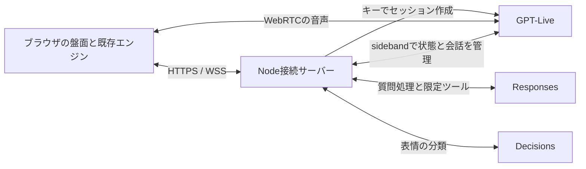

# 絵しりとり 音声対戦相手の設計

作成日: 2026-10-31（日本時間）
要件: [音声対戦相手の要件](live-opponent-api-requirements.md)
用途: 別スレッドで実装を開始できる設計基準。以下のアプリ用インターフェースは新規設計であり、OpenAI SDKの既存メソッド名ではない。

## 1. 構成と初期判断

既存のブラウザゲームへ音声機能を追加する。ブラウザ内の既存エンジンをゲーム状態の正本として維持し、Node.jsの接続サーバーは公開可能な状態のコピー、音声接続、モデル呼び出しを管理する。ゲーム本体をサーバーへ移植することは初期版の前提にしない。



- ホストPC上でキーを保持する。接続端末がホストかLANかで認証情報の置き場所を変えない。
- Liveはclient delegationを基本とする。アプリ側で現在状態・履歴を選び、必要な時だけResponsesを呼べるため。
- Decisionsは初期版では接続サーバーから直接呼ぶ。頻度制限、結果の破棄、オンオフ、障害時の切り離しを一か所で制御する。
- LiveのネイティブDecisionsトリガーは後続の比較対象。初期版で両方を同時に動かして二重分類しない。
- ネイティブトリガーを使う場合、音声セッションのdelegation設定とトリガー設定は別物として扱い、実際の対応スキーマを確認する。
- ブラウザとサーバーの間で、任意のOpenAIリクエストをそのまま中継する汎用プロキシは作らない。
- APIキー不要の既存起動は維持する。音声サーバーを別の起動コマンドとして追加する。

## 2. 既存コードとの接続点

| 既存ファイル                | 利用・変更方針                                                                      |
| --------------------------- | ----------------------------------------------------------------------------------- |
| src/game/state.ts           | reducerを正本にする。音声操作も同じAction経路を通す。                               |
| src/game/rules.ts           | 合法手・使用済み・承認済み読みの判定を再利用する。                                  |
| src/game/cpu.ts             | CPU方策を変更しない。                                                               |
| src/game/cpuPresentation.ts | scan / compare / locked、既存の探す時間とカーソル演出を会話イベントへ変換する。     |
| src/App.tsx                 | VoiceControllerの接続、セマンティックな状態変更の通知、字幕と設定の入口を追加する。 |
| src/ui/readingHint.ts       | ヒント第2段階の表示内容を再利用する。                                               |
| src/ui/CpuCompanion.tsx     | CpuMoodへ会話由来の一時的な表情を重ねる。                                           |
| src/storage/save.ts         | 秘密・音声セッション・会話を保存対象に混ぜない。                                    |
| tools/serve.mjs             | 既存の4173配信を維持する。音声サーバーでリポジトリ全体を配信しない。                |
| src/pwa.ts / PWA設定        | 音声API・認可情報・会話をキャッシュ対象外にする。                                   |

現在の手詰まりはnoMovesによる盤面クリア。rescuingは旧保存の互換処理が残るだけなので、自発イベントとして旧つなぎ直しを生成しない。早押しの探索演出は交互対戦とは異なるため、初期版の音声対象に含めない。

## 3. モジュール案

```text
src/voice/
  protocol.ts             アプリ用の状態・イベント・操作の型
  projectGameView.ts      GameStateから公開可能な情報だけを作る
  deriveGameEvents.ts     状態差分から一回だけイベントを作る
  VoiceController.ts      UI接続、送受信、マイク、再生、切断
  VoicePanel.tsx          接続設定、字幕、マイク・音声の操作
  moodPresentation.ts     既存表情と会話表情の優先順位

src/game/
  hintPresentation.ts     画面と音声に共通のヒント内容を返す小さな関数

server/voice/
  index.ts                HTTP(S)、静的配信、WSS、終了処理
  config.ts               環境変数とモデル設定
  pairing.ts              ペアリング・端末セッション・Origin検査
  sessionRegistry.ts      単一音声接続、所有者、期限、リース
  openaiLiveAdapter.ts     セッション作成、sideband、開始・停止
  backendService.ts       Responses、限定ツール、要求の重複排除
  decisionsService.ts     表情分類、上限、結果の整列
  conversationDirector.ts 発言機会、優先順位、有効期限、割り込み
  contextBuilder.ts       公開状態、今回の記憶、直近発言の選択
  usage.ts                セッション時間・モデル利用量
```

名前やファイル数は実装に合わせて調整してよい。ゲームロジック、OpenAIアダプター、会話の演出判断は分離する。server用TypeScript設定はDOM用と分け、serverコードやキーをフロントのbundleへ入れない。

## 4. 状態の正本と公開用ビュー

### 4.1 状態識別子

- gameId: ブラウザの一回のゲーム起動を識別するID。
- boardEpoch: 新しい盤面、再挑戦、インポートで変えるID。round番号だけで判定しない。
- revision: 会話に関係する確定状態が変わった時に単調増加する値。
- turnId: boardEpoch、確定した手数、actorなどから定義する手番ID。
- connectionEpoch: 音声を再接続するたびに変えるID。
- eventId / requestId: イベントと変更要求の重複排除用ID。

TICKの毎フレームでrevisionを増やさない。盤面、head、手番、確定した手、ヒント、選択、ポーズ、結果などの変化を対象とする。サーバーは巻き戻ったrevisionや別epochの更新を破棄する。

### 4.2 GameVoiceViewの内容

以下はアプリ内部のデータ設計例である。

```typescript
interface GameVoiceView {
  gameId: string;
  boardEpoch: string;
  revision: number;
  turnId: string;
  phase: string;
  actor: "player" | "cpu";
  head: string;
  cards: Array<{
    id: string;
    slot: number;
    description: string;
    available: boolean;
  }>;
  selectedCardId?: string;
  lastMove?: {
    id: string;
    actor: "player" | "cpu";
    assetId: string;
    display: string;
    kana: string;
    kind: string;
    explanation: string;
    discovery?: "new" | "complete";
  };
  hint: { level: number; used: number; canRequest: boolean };
  opponent: { variant: string; searchStage?: "scan" | "compare" | "locked" };
  result?: { winner: "player" | "cpu" | null; reason: string };
}
```

- cardsは現在表示されている札だけ。descriptionは既存の承認済み絵説明を使う。
- 選択された札の位置と選択IDで「これ」「右上の札」を解決する。曖昧なら短く確認し、勝手に札を確定しない。
- 読み辞書全体、未発見読み一覧、全合法手一覧、Board.proof、補充予定、CPUの未確定の選択を含めない。
- APIキー、ファイルパス、ホストの設定情報を含めない。
- 生のGameStateやsrc/generated/content.jsonを丸ごとモデルへ渡さない。
- 文字・位置・札が分かれば画像を毎フレーム送らない。画像入力は明示選択した札を詳しく見る後続機能に留める。
- 上位のヒントは別の処理で、要求と段階が確定した後にだけ渡す。

### 4.3 同期

接続時・再接続時は完全な公開ビューを送る。その後は確定イベントにビューの更新を付ける。初期版では小さい完全ビューを再送してもよい。画像バイト列や全辞書を差分へ混ぜない。

UIのstate変更後にイベントを作り、モデルが言ったことからstateを推測しない。イベント生成はStrictMode、再描画、ロードで同じeventIdを重複送信しない。

## 5. 自発発言の設計

### 5.1 イベント

| イベント              | 発言材料                       | 有効期限                                     |
| --------------------- | ------------------------------ | -------------------------------------------- |
| board.ready           | 絵の顔ぶれ、head、今回の開始   | 最初の着手まで                               |
| cpu.search.started    | head、見えている絵、直近の会話 | CPU着手、ポーズ、割り込みまで                |
| cpu.move.committed    | 確定した読み・理由・次文字     | 次の確定着手まで                             |
| player.move.committed | 確定した回答                   | 次の確定着手まで                             |
| reading.discovered    | 今回の確定済み発見             | 次の盤面まで。遅ければ振り返り材料へ回す     |
| board.completed       | 正式な結果、今回の発見         | 次の盤面まで                                 |
| selection.changed     | 選択札                         | コンテキスト更新のみ。毎回の発話は起こさない |
| game.paused / resumed | 休止状態                       | 状態更新中心。連続通知を話さない             |

イベント名はアプリ用であり、OpenAIの実イベント名ではない。

### 5.2 ConversationDirector

Directorは「いつ・何について・どの程度話してよいか」を決め、言い回しはLiveへ任せる。

1. 現在状態とイベントの整合性を確認する。
2. プレイヤーが発話中、質問待ち、別の高優先発話中なら低優先の独り言を抑制する。
3. 頻度設定、直近発言、クールダウン、eventIdで発言機会を選ぶ。
4. 最新の事実を静かなコンテキストとして送り、今回の短い発話機会を通知する。
5. 時間切れ・手番変更で未送信の機会を捨て、送信済みの古い発話はアダプターの中断と再生制御で抑える。
6. 生成・字幕到着・再生を別々に記録する。モデルへ送れたことを「ユーザーが聞いた」と扱わない。

会話の優先順位は、停止・割り込み > プレイヤーへの直接応答とヒント > 着手・結果 > 発見への反応 > 探す独り言。低優先の発言をFIFOで溜めない。未処理の探索機会は一つまで。

### 5.3 遅延と発話長

- 探索の独り言は短い1フレーズ。初期目安は1～2秒程度の発声量。
- 着手・発見への反応は通常1文。質問・説明もまず1～2文にし、求められた時に詳しくする。
- CPUの既存2.2～3.4秒程度の探索時間を、モデル応答待ちで伸ばさない。
- 準備が遅れた探索発言は無言にする。後から再生して追いかけない。
- 着手の読み上げが遅い場合もゲームを止めない。次の着手で古くなったら捨てる。
- 質問に対しては必要なら短い相づちを使えるが、同じ「少々お待ちください」を繰り返さない。

### 5.4 変化と一貫性

contextBuilderが次をLiveへ渡す。

- 現在の公開ビューの要点。
- 直近の会話と、最近の自発発言の一覧。初期目安12発言まで。
- 今回の対戦で起きた発見・印象的な出来事。初期目安3件まで。
- 相手の性格、発話頻度、直近に使いすぎた表現。
- 今回許可された話題と、確定した事実。

発話機会では「短い独り言」「見えている絵の観察」「直前の回答に反応」「沈黙」のような種類を変えられる。選択にはゲームのseedとは独立した乱数を使う。温度パラメーターが利用可能であることを前提にせず、実APIの対応範囲で調整する。

生成した文の完全一致や強い類似が連続する場合、自発発言を抑えるか一度だけ再生成する。ヒントの再読み上げ、確定した単語の発声は繰り返し抑制の例外。再生成を繰り返してゲームを待たせない。

今回の記憶は確定したイベントとプレイヤーの明示発言から作る。「猫が得意なんだね」など、少数の回答から性格・能力・感情を断定しない。割り込みで再生しなかった発言を、言ったことにして後から参照しない。会話終了で記憶を捨てる。

### 5.5 初期プロンプトの方針

```text
あなたは盤面を共有して絵しりとりを一緒に遊ぶ相手。
短く自然な日本語で話し、プレイヤーが考えている間は静かにする。
ゲームの状態と確定結果はアプリから届く情報を使う。
未確定の手、未発見の読み、頼まれていないヒントを先に言わない。
自分の着手は確定通知後だけ伝える。
同じほめ方や問いかけを続けず、必ず質問で締めない。
今回の会話と実際の発見を覚え、関連する時だけ自然に触れる。
操作・ヒント・読みの理由が必要な時はバックエンドに委譲し、
実行結果が返ってから、それに基づいて伝える。
プレイヤーが話し始めたら聞く。訂正・否定を優先する。
```

これは基礎方針であり固定の発話文ではない。実装では公開情報の送信範囲、ツールの認可、操作の検査をコードでも実行する。

## 6. 会話からの操作とヒント

### 6.1 限定したツール

以下は新規に実装するアプリ用ツール例。

| 名前                     | 機能                                        | 変更                 |
| ------------------------ | ------------------------------------------- | -------------------- |
| game.get_public_view     | 現在の公開可能な状態を取得                  | なし                 |
| game.explain_last_move   | 直前の確定済みの読みの理由を取得            | なし                 |
| game.request_hint        | open / repeat / next / answerを指定して要求 | ヒント段階・参照状態 |
| game.set_chatter         | quiet / normal / chattyを設定               | 会話設定だけ         |
| game.pause / game.resume | 明確な要求による休止・再開                  | 既存のActionで実行   |
| voice.stop               | 音声接続を終了                              | 音声だけ             |

submit、CPU方策変更、辞書編集、ファイル操作、シェル、Web検索は公開しない。ユーザーの発言は会話データであり、アプリの指示・権限として扱わない。

### 6.2 操作の流れ

Liveの委譲を接続サーバーで受け、文字起こしと最新公開ビューからResponsesへの依頼を作る。文字起こし断片だけで操作を実行しない。Liveの委譲ID、アプリのutteranceId、requestIdの関連を保持する。

ブラウザのエンジンを変更する要求は、次の順序で扱う。

1. 接続サーバーがツール名・引数・所有者・対象盤面・requestIdを検査する。
2. 所有者ブラウザへ、要求と期待するboardEpoch / revisionを送る。
3. ブラウザが現在stateを再確認し、同じrequestIdを未実行の場合だけ共通Action経路へ渡す。
4. 更新後の公開ビューと実行結果をサーバーへ返す。
5. サーバーがモデルへ実際の結果を返し、Liveが伝える。

revisionが変わった要求を盲目的に適用しない。最新状態を返して再評価する。通信タイムアウトを理由に、別のrequestIdで同じ消費操作を自動再試行しない。ヒントが消費されたかはエンジンの結果で確定する。

### 6.3 ヒントの共通化

現在App.tsx内にある対象の選択・段階の文面を、hintPresentationなどへ抽出し、画面と音声が同じ関数を使う。

- open: hintLevelが0なら既存HINTを1回実行。既に開示済みなら現在段階を返す。
- repeat: 現在段階を再提示。消費しない。まだ未開示ならopenと同じ。
- next: 明確な追加要求の場合だけ、既存規則内で1段階進む。
- answer: 既存画面で第3段階まで進めるのと同じ消費を適用する。現行ではHINTの第3段階であり、図鑑の答え表示のREFERENCEとは別。音声だけREFERENCEを発火したり、scoreHelpの区分を変更したりしない。実装時も現行の画面操作と比較する。
- プレイヤー手番以外は段階を進めず、現在は使えない理由を返す。
- 対象の札は現在の画面と同じ選択規則で決める。モデルが別の札を選んで消費しない。

音声へ返すpayloadは、許可されたhintText、level、used、公開可能な対象札情報だけ。下位段階でkanaやdisplayなどの答えフィールドを付けない。

自由な会話モデルが絵から答えを推測する可能性は残る。入力の最小化、自発ヒント禁止、言い換えの検査で抑える。文字起こし検知後に音声を止めるだけでは、発声前の完全な漏えい防止とは扱わない。実試験で漏れる場合、ヒント部分だけ検証済みテキストを発声する専用経路を追加してから合格にする。

## 7. Decisionsと表情

初期版は表情の補助選択を担当する。会話操作の主ルートはResponsesの限定ツールとし、同じ発話をDecisionsとResponsesの両方から実行しない。

- 入力: 短い会話区間、話者、公開ゲーム状況。
- 出力: 既存CpuMoodへ対応できる表情、強さ、必要なら軽い仕草。列挙型で受ける。
- 例: watching / thinking / surprised / happy / resting。エンジンの探索・結果表情と競合しない範囲。
- 「ユーザーの本当の感情」ではなく、聞き手として取る表情を選ぶ質問にする。
- 表情のために話の途中を扱う場合でも、ヒント消費や休止を実行しない。
- 接続サーバーで意味のある区間をまとめ、最大1リクエスト/秒、1件だけ実行中を初期値とする。
- 同じ文字起こしを重複評価しない。残り入力は最新だけ保持する。
- 結果にutteranceId、sourceEventId、direction、connectionEpochを関連付ける。遅れて届いた結果で新しい表情を巻き戻さない。
- 一時表情は初期目安2秒で解除。ゲーム由来の結果・探索表情を上書きし続けない。
- 失敗・拒否・未知のenum・権限なしは無視し、既存表情へ戻す。連続エラーはその接続で停止する。

口の動きが必要なら実際の音声出力に合わせる。Decisionsの到着を音声再生の時刻として使わない。動きを減らす設定では口や身体の連続アニメーションを抑える。

## 8. 接続サーバーとLAN

### 8.1 起動

提案する起動経路:

```text
npm ci
npm run build
npm run voice:build
npm run voice
```

上記voice系コマンドは今回追加するもの。既存のnpm run serveは変更しない。音声サーバーはビルド済みdistを配信し、初期ポートは4174。通常版4173と同時に起動できる。

ローカルモードは127.0.0.1に限定する。LANモードは明示オプションで有効化し、信頼できるTLS設定がない場合は音声を開始できないと案内する。既存HTTPゲームのLAN配信はそのまま使える。

Vite開発時も、APIとWSSは同じオリジンになるよう開発用プロキシを用意する。LANマイクを開発時に試す場合もHTTPSを使う。

### 8.2 提案する環境変数

| 変数                                  | 初期方針                                  |
| ------------------------------------- | ----------------------------------------- |
| OPENAI_API_KEY                        | 必須。ホスト側だけで読む                  |
| OPENAI_LIVE_MODEL                     | gpt-live-1。利用可能性は接続時に確認      |
| OPENAI_BACKEND_MODEL                  | gpt-6-lunaを初期候補とし設定可能にする    |
| OPENAI_DECISIONS_MODEL                | 現行公式仕様に対応するgpt-6-luna          |
| OPENAI_LIVE_VOICE                     | 任意。実APIが提供する声だけを選ぶ         |
| VOICE_PORT                            | 4174                                      |
| VOICE_LAN                             | false。明示時のみLANへ公開                |
| VOICE_TLS_CERT / VOICE_TLS_KEY        | LAN用の証明書・鍵のパス                   |
| VOICE_ALLOWED_ORIGINS                 | 正確なscheme・host・portの許可リスト      |
| VOICE_MAX_SESSION_SECONDS             | 初期900秒                                 |
| VOICE_IDLE_CLOSE_SECONDS              | ポーズ・結果・タイトルで無操作60秒        |
| VOICE_DECISIONS_ENABLED               | true。個別に無効化可能                    |
| VOICE_MAX_BACKEND_CALLS_PER_MINUTE    | 初期12。実行中のバックエンド処理は1件まで |
| VOICE_MAX_BACKEND_CALLS_PER_SESSION   | 初期120。到達時は新規委譲を止めて案内     |
| VOICE_MAX_DECISIONS_CALLS_PER_SESSION | 初期300。到達時は既存表情へ戻す           |
| VOICE_DEBUG_TRANSCRIPTS               | false                                     |

キーや秘密をVITE_変数へ入れない。.env.exampleは空のキー欄と説明だけ。証明書・秘密鍵・実キー・ログを配布物に入れない。既存.gitignoreの対象を確認して必要分だけ追加する。

### 8.3 アプリのAPI案

すべて新規のゲーム専用エンドポイント。実装時の名前変更はよいが用途と制限は維持する。

| エンドポイント            | 用途                                             |
| ------------------------- | ------------------------------------------------ |
| GET /voice-api/status     | 利用可否・接続状態。キーや認証情報は返さない     |
| POST /voice-api/pair      | コード確認、端末認可Cookie発行                   |
| POST /voice-api/session   | 検査済みSDPからLive接続を作る                    |
| DELETE /voice-api/session | 所有者の接続を閉じる                             |
| GET /voice-api/usage      | 所有者に時間・利用量を返す                       |
| WSS /voice-api/events     | 公開ビュー、イベント、操作要求と結果、字幕・表情 |

リクエストでAPIキー、任意のモデル設定、任意URL、任意のOpenAI JSONを受け付けない。model・instructions・toolsはサーバー側が構成する。SDPやJSONのサイズ上限、受信頻度、タイムアウトを設定する。

### 8.4 ペアリングと端末制御

ホストのターミナルにURLと一時コードを表示する。コードは一回限り・初期5分で失効、試行回数を制限する。認可後はHttpOnly / SameSiteのCookieと、変更要求用の検証を使う。HTTPSではSecureを付ける。

Originは設定済みの完全一致リストで検査し、Hostヘッダーだけから許可を作らない。WSSも認可する。ペアリング済みであることだけで、他端末の音声セッションを終了できないよう所有者を検査する。

一つの音声スロットを確保し、作成中も重複開始を防ぐ。初期版の2台目は409相当の使用中とする。ホスト管理者は停止できるが、LAN端末が勝手に横取りしない。

## 9. OpenAIアダプター

### 9.1 作成と送受信

ブラウザがマイクとRTCPeerConnectionを用意し、SDP offerをホストへ送る。ホストが公式のLiveセッション作成APIを呼び、SDP answerを返す。ブラウザのデータチャネルでsession.startedを待ち、ホストは同じセッションにsideband接続する。

WebRTCのHTTP作成で既に開始されるため、ブラウザからsession.startを重ねて送らない。sidebandは実際に作成したセッションIDと所有者の対応を保持する。

- 初期はstore:false。
- delegation.typeはclient。
- session.thinking.appendは現在の事実、session.commentary.appendは発話機会、session.instructions.appendは信頼できる行動指示に使い分ける。
- アプリ操作はsidebandを通してホストが扱う。実APIのフロントエンド権限設定を確認し、端末からモデル・ツール・判定トリガーを自由に変更できない構成にする。
- appendの応答はコンテキストの受理を示す。発話完了や実際に聞こえたことを示すとは扱わない。
- appendの長さ上限を守り、全盤面の大きいJSONを一つの500トークン枠へ押し込まない。初期要約と関連する差分へ分け、完了前に次の発話を要求しない。

### 9.2 イベントの正規化

OpenAIイベントを直接Reactやゲームへ流さず、アダプターで次のアプリイベントに変換する。

```text
voice.ready
voice.input_fragment
voice.user_utterance
voice.assistant_fragment
voice.delegation_requested
voice.playback_state
voice.usage
voice.closed
voice.error
```

これらはアプリ独自名。実APIの文字起こしdeltaを、存在未確認のdoneイベントと組み合わせて実装しない。実際のSDK・イベント仕様を確認し、VAD・時刻・委譲の関連で意味のある発話区間をまとめる。途中の文は後から訂正され得る。

同じdelegationを、ブラウザデータチャネルとsidebandの両方で二重処理しない。サーバー側を委譲・使用量の処理担当に固定し、eventIdとdelegationIdで重複を落とす。

### 9.3 割り込みと再生

プレイヤーの発話開始で、低優先の未送信発話を捨てる。送信済みの中断には、選んだLive APIの実際の再生制御を使う。汎用Responsesのresponse.cancelなどを、確認せずLiveへ送らない。

字幕とWebRTC音声は同時刻とは限らない。字幕から全音声完了を推測しない。古い発話が残るケースを実音声で確認する。音量を下げるだけで古い発言が後から復活しないようにする。

## 10. セッション終了と利用量

状態は off → pairing / connecting → active → closing → off。失敗はerrorへ遷移し、ゲーム自体は既存操作で動く。

- 音声開始はボタン操作後だけ。接続準備だけでセッションを大量作成しない。
- 明示停止、ホスト終了、最大時間、所有者の通信リース切れで閉じる。
- ページ終了の通知は届かない場合があるため、ブラウザの終了イベントだけに依存しない。WSS heartbeatで所有者の生存を確認し、リース切れで閉じる。
- 通常の思考中の沈黙で頻繁に切断しない。idle timeoutは初期版ではポーズ・結果・タイトルの無操作に適用する。
- 最大時間の前に案内し、延長は利用者の明示操作とホスト設定内で行う。
- マイクミュートは入力を止めるだけ。再生ミュートも接続終了ではない。
- 停止時はsession.closeを送り、session.closedを待って最終利用量を確定する。タイムアウトや通信障害なら未確定と表示し、ゼロと報告しない。
- 累積usage.secondsの更新を足し合わせない。各セッションの最終値を一度だけ集計する。
- ResponsesとDecisionsはリクエストIDごとに使用量を一度計上する。音声時間と別に表示する。
- 料金は取得済みの単価設定で推定する。上限はアプリ内の抑制であり、API側の絶対的な請求上限を保証すると表示しない。

リトライは少数回・バックオフ付き。音声セッション作成の結果が不明な場合は無条件に再作成しない。接続失敗や再接続自体にも初期化料金が生じ得るため、無限自動再接続をしない。

## 11. 画面と操作

対戦画面の盤面サイズを維持する。接続設定はタイトルまたは一時停止メニュー。字幕は既存の案内領域を活用し、長い会話履歴はパネル内でスクロールする。

最低限の表示:

- 会話開始 / 終了。
- 接続中 / 聞いている / マイク停止 / 再接続が必要。
- マイクと相手音声の独立した操作。
- 字幕オンオフ、発話頻度、Decisionsオンオフ。
- 接続時間と使用量。モデルや詳細は設定パネルに置く。
- LAN接続の案内と、API料金はホストに発生する説明。

入力ミュート中も、対戦イベントへの自発発言は許可できる。出力ミュートは別扱い。既存の消音設定との関係をUIで明示し、少なくとも既存消音中に勝手に声を再開しない。設定値だけを保存し、APIキー・Cookie・接続ID・会話をゲーム保存へ混ぜない。

## 12. 試験と検証

### 12.1 自動試験

- 公開ビューからproof、reserve、未発見語、キーが除外される。
- 同一イベント、同一requestId、二重委譲でヒント消費が一回になる。
- open / repeat / next / answerと画面操作の段階・参照状態が一致する。
- 否定、言い直し、曖昧な発話は消費操作を起こさない。
- 遅れた探索発言・表情・ツール結果を旧epochへ適用しない。
- pause、次の盤面、replay、切断で低優先発言を破棄する。
- Decisions失敗、Live失敗、429、モデル権限なしでゲームが動く。
- 未認可、別Origin、別所有者、コード再利用、二重接続を拒否する。
- 使用量の累積値とリクエストを重複計上しない。
- 標準ゲームのCPU決定、リプレイ、保存、現行スコアの回帰を確認する。

モックは時間・失敗・順序の検証に使う。モックで会話が出ただけでは実API接続の合格にしない。

### 12.2 実APIと実端末

最初に小さく、接続→一往復→盤面イベントによる自発発話→終了を確認する。その後ヒントとDecisionsを組み込む。課金試験には利用者が設定したキーと予算が必要で、コードへ秘密を埋めない。

対象はホストPCのブラウザと、同一LANの別端末。ブラウザ名・版、OS、証明書条件、ネットワーク条件、マイク許可、スピーカー確認を記録する。PC上のモバイル表示を、実機スマホのマイク・証明書試験の代わりにしない。

自然さは要件書A17/A18に沿って評価する。少なくとも実際の生成、状況への具体的な反応、繰り返し、割り込み、沈黙を確認する。発話のバリエーション例と、不自然だった例を報告する。遅延はイベントから音声開始、ユーザー要求から応答開始を別に記録し、目標値を達成したと事前に主張しない。

## 13. 実装順と成果物

1. 現在のソースとテストを確認し、追加機能の境界を作る。
2. 音声サーバー、キー設定、localhost接続、Liveの一往復と終了・使用量。
3. 公開ビューとイベントを接続し、生成による自発発言と古い発話の破棄。
4. 共通ヒント処理と限定ツール。実行後の状態を確認して会話へ返す。
5. Decisionsの表情、オンオフ、既存表情への復帰。
6. HTTPS、ペアリング、LAN実端末、単一接続の制御。
7. 自然さを試遊して調整し、回帰確認、起動手順、検証報告、配布物を整える。

LANは必須であり、最後まで未対応のまま完成とはしない。既存の素材・辞書・セーブを再生成・破棄しない。

成果物はソース、ロックファイル、空の.env.example、ローカル/LAN起動手順、証明書手順、障害対応、実APIと実端末の検証報告。秘密を除いた配布物を作り、実行時の依存とNode.js要件を記載する。実施できない検証は、モック合格と分けて未検証と記載する。

## 14. 仕様根拠と参照先

API仕様の確認日: 2026-10-31。モデル権限やSDKのフィールドは実装開始時に公式仕様と照合する。以下にないアプリ用の型・エンドポイント・数値は本設計の提案値である。

- [Live WebRTC](https://developers.openai.com/api/docs/guides/voice-webrtc?api=live#connect-a-browser-to-gpt-live): 接続、キーの保持、マイクの条件。
- [Live client delegation](https://developers.openai.com/api/docs/guides/live-delegation#configure-client-delegation): 独自バックエンドとの委譲。
- [Liveのコンテキスト追加](https://developers.openai.com/api/docs/guides/live-conversations#add-context-during-the-conversation): 事実、発話、行動指示の区別。
- [Live server controls](https://developers.openai.com/api/docs/guides/voice-server-controls): sidebandと再生制御。利用フィールドは実装時に取得して確認する。
- [Decisions](https://developers.openai.com/api/docs/guides/decisions#choose-a-question-type): predicate / choice / score。
- [LiveとDecisions](https://developers.openai.com/api/docs/guides/decisions-voice#react-to-transcripts): 文字起こしとの関連、結果の順序。
- [Liveの使用量とコスト](https://developers.openai.com/api/docs/guides/voice-latency-cost?api=live#gpt-live-usage-and-costs): 接続時間とバックエンド利用料の分離。

## 2026-10-31 実装で確認・調整した点

- 公式OpenAI Node SDK 7.46.0のLive／Sideband／Responses／Decisionsの実在する型を使用。モデルと上限はホスト設定で変更可能。
- WebRTCはマイク入力に使用。ブラウザのネイティブ受信ではRTPを受信してもAudioContextへの出力が無音になる組み合わせがあったため、出力はsidebandの24kHz PCMを所有者限定WSSへ中継し、0.9秒上限のAudioWorkletで再生・破棄する。APIキーや任意のOpenAIリクエストを中継する構成にはしない。
- 初期の公開ビューはsession.inputへ含め、その後は変わった札・状態だけを500トークン以内のappendへ分割。UTF-8で480バイト以下を上限とする。確認できなかった文脈からは自発発話を要求しない。
- SDKのTranscriptDeltaのclient_event_idとゼロ長区間を確認し、アプリの文脈反映を人の声・操作として扱わない。
- Liveには発話完了イベントを仮定しない。ローカルVADの終了と字幕の安定を合わせて扱い、委譲と明確な要求の補完処理を同じutterance IDへまとめる。すべての消費操作をResponsesとエンジンの確認経路に限定する。
- 不明な要求・中断したAPI利用量は未確定として残し、上限判定には保守的な予約額を含める。推定額は請求上限ではない。
- 実機スマホ／タブレットのマイクとOS信頼設定は、自動ブラウザ・LAN IPの到達確認と分けて検証報告へ記載する。

- 説明要求は短い発話でもResponsesの説明ツールへ明示的に回す。第3段階の答えだけはエンジンの承認済み理由も返し、直後の「今の読み」の説明に利用する。第1・2段階にはこの理由を含めない。次の盤面・次の着手で公開済みヒントの理由を捨てる。確定着手を指定した質問は着手の理由を優先する。
